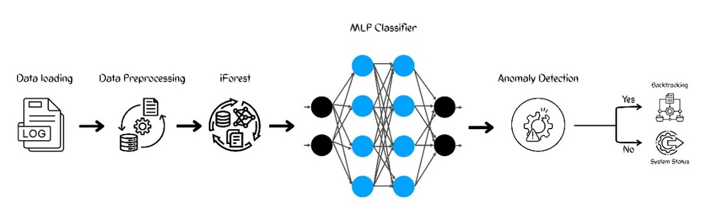

# iForMB

[](https://github.com/Enock02333/iForMB/actions/workflows/ci.yml)

**An integrated Isolation Forest–MLP framework with contextual backtracking for distributed-system log anomaly detection.**



## 1. Scientific objective

System-log anomaly detection is difficult because labels are scarce, anomalies are rare, and later operating periods may differ from the data used during model development. Isolation Forest can quantify unusualness without labels, but its path-length score is not a task-specific decision boundary. An MLP can learn a nonlinear labelled boundary, but it does not explicitly preserve the unsupervised evidence associated with an observation.

iForMB combines these two forms of information. The framework:

1. constructs dataset-specific log features;
2. fits an Isolation Forest on **normal training observations only**;
3. calibrates the Isolation Forest response into three evidence features;
4. concatenates the evidence with the original log representation;
5. trains an MLP on independently supplied labels where available;
6. selects the operating threshold from validation data under an FPR constraint;
7. applies contextual backtracking only after an anomaly decision.

The repository implements the complete pipeline for the original synthetic development dataset, HDFS, and BGL.

## 2. Mathematical formulation

### 2.1 Isolation evidence

For a subsample of size \(\psi\), the expected unsuccessful-search path length is

$$
c(\psi)=2H(\psi-1)-\frac{2(\psi-1)}{\psi}.
$$

For observation \(x\), the Isolation Forest score is

$$
s_{IF}(x)=2^{-\mathbb{E}[h(x)]/c(\psi)}.
$$

Let \(S_0=\{s_1,\ldots,s_m\}\) be Isolation Forest scores from normal training observations. iForMB derives

$$
p_{IF}(x)=\frac{1}{m}\sum_{j=1}^{m}\mathbf{1}[s_j\le s_{IF}(x)]
$$

and

$$
z_{IF}(x)=\frac{s_{IF}(x)-\mathrm{median}(S_0)}{1.4826\,\mathrm{MAD}(S_0)+\epsilon}.
$$

The calibrated evidence vector is

$$
e(x)=[s_{IF}(x),p_{IF}(x),z_{IF}(x)]^\top.
$$

Implementation: [`src/ifor_mb/calibration.py`](src/ifor_mb/calibration.py).

### 2.2 Early feature-level fusion and MLP

Given dataset-specific feature vector \(x\), the detector input is

$$
u(x)=[x^\top\;\Vert\;e(x)^\top]^\top.
$$

The MLP computes

$$
a^{(\ell)}=\mathrm{ReLU}(W^{(\ell)}a^{(\ell-1)}+b^{(\ell)}),
$$

with hidden widths 128 and 64, followed by

$$
P_\theta(y=1\mid x)=\sigma(W^{(3)}a^{(2)}+b^{(3)}).
$$

Implementation: [`src/ifor_mb/models.py`](src/ifor_mb/models.py).

### 2.3 Validation-constrained operating point

The decision threshold is selected from validation data:

$$
\tau^*=\arg\max_\tau F1_{val}(\tau)\quad\text{subject to}\quad FPR_{val}(\tau)\le 0.001.
$$

Implementation: [`src/ifor_mb/evaluation/thresholds.py`](src/ifor_mb/evaluation/thresholds.py).

### 2.4 Contextual backtracking

For anomalous query event \(q\), candidate prior event \(l_i\) is represented by

$$
r(l_i,q)=\left[\mathbf{1}(n_i=n_q),\mathbf{1}(c_i=c_q),\mathbf{1}(t_i=t_q),\mathbf{1}(v_i=v_q),J(M_i,M_q),-\Delta t_{iq}\right].
$$

The ranker uses node, component, event type, severity, message-token Jaccard similarity, and temporal proximity. BGL relevance categories are excluded from ranking and are used only afterward to calculate Recall@k and MRR.

Implementation: [`src/ifor_mb/backtracking/contextual.py`](src/ifor_mb/backtracking/contextual.py).

## 3. End-to-end pipeline

```text
Input logs
  |
  +-- schema validation / parser
  +-- training-fitted feature engineering
  |
  +-- normal-only Isolation Forest
  |     +-- raw score
  |     +-- normal-score percentile
  |     +-- robust z-score
  |
  +-- early feature-level fusion
  +-- MLP training and anomaly probability
  +-- validation-constrained threshold
  +-- test anomaly decision
        |
        +-- normal: system status
        +-- anomalous: contextual backtracking
                       +-- ranked prior operational evidence
```

## 4. Dataset roles

| Dataset | Scientific role | Unit | Ground truth | Public implementation |
|---|---|---|---|---|
| Synthetic Log Data of Distributed System | Original pipeline development and workflow demonstration | Structured log record | No independent binary fault label | `src/ifor_mb/synthetic/` |
| HDFS_v1 | Independently labelled conventional and unseen-type evaluation | Block event sequence | External block label and failure type | `src/ifor_mb/experiments/hdfs_*.py` |
| BGL | Chronological labelled evaluation and backtracking assessment | Non-overlapping 20-event window / episode onset | First-token alert category | `src/ifor_mb/experiments/bgl_chronological.py`, `src/ifor_mb/backtracking/` |

The synthetic pipeline explicitly labels its IF-derived targets as a **development oracle**, not independent detector ground truth.

## 5. Repository structure

```text
src/ifor_mb/
├── calibration.py                 # calibrated Isolation Forest evidence
├── models.py                      # reusable IFMLPDetector
├── synthetic/
│   ├── schema.py                  # original-dataset schema and aliases
│   ├── features.py                # time, categorical, numeric, message features
│   ├── pipeline.py                # complete original-dataset workflow
│   └── demonstration.py           # source-data description
├── experiments/
│   ├── hdfs_conventional.py
│   ├── hdfs_heldout_type.py
│   ├── hdfs_matched_unseen.py
│   └── bgl_chronological.py
├── baselines/
│   ├── deeplog.py
│   └── logrobust.py
├── backtracking/
│   ├── contextual.py
│   └── bgl_backtracking.py
└── evaluation/
    ├── metrics.py
    └── thresholds.py
```

## 6. Clone and install

### Windows PowerShell

```powershell
git clone https://github.com/Enock02333/iForMB.git
cd iForMB
python -m venv .venv
.\.venv\Scripts\python.exe -m pip install --upgrade pip
.\.venv\Scripts\python.exe -m pip install -e ".[dev]"
.\.venv\Scripts\python.exe -m pytest
.\.venv\Scripts\python.exe scripts\verify_release.py
```

### Linux or macOS

```bash
git clone https://github.com/Enock02333/iForMB.git
cd iForMB
python3 -m venv .venv
.venv/bin/python -m pip install --upgrade pip
.venv/bin/python -m pip install -e '.[dev]'
.venv/bin/python -m pytest
.venv/bin/python scripts/verify_release.py
```

Run installation commands **inside the cloned `iForMB` directory**. Running them from the manuscript-revision workspace fails because that directory is not the Python package.

## 7. Prepare datasets

Raw data are not redistributed. Follow [`data/README.md`](data/README.md) and create:

```text
data/external/
├── synthetic/
│   └── synthetic_logs.csv
├── hdfs/
│   ├── Event_occurrence_matrix.csv
│   ├── Event_traces.csv
│   └── anomaly_label.csv
└── bgl/
    └── BGL.log
```

Validate the HDFS/BGL data contract:

```powershell
.\.venv\Scripts\python.exe -m ifor_mb.cli verify-data --data-root data/external
```

## 8. Run the original synthetic pipeline

```powershell
.\.venv\Scripts\python.exe scripts\run_synthetic_pipeline.py `
  --input data\external\synthetic\synthetic_logs.csv `
  --output results\runs\synthetic `
  --seed 13
```

Stages executed:

1. resolve structured column names;
2. generate cyclic hour and weekday features;
3. encode service, user, and client fields;
4. hash message text;
5. construct a 60/20/20 development split;
6. create a train-fitted Isolation Forest development oracle;
7. calculate calibrated IF evidence;
8. train the fused MLP;
9. choose the validation threshold under the FPR constraint;
10. write `synthetic-development-summary.json`.


The output directory contains:

```text
results/runs/synthetic/
└── synthetic-development-summary.json
```

The summary records the dataset role, seed, split counts, validation-selected threshold, calibrated-evidence dimensions, and predicted-anomaly count. It also carries an explicit warning that the synthetic targets are IF-derived development targets rather than independent ground truth.

Illustrative schema only (values depend on the downloaded dataset and seed):

```json
{
  "dataset_role": "framework development and workflow demonstration",
  "independent_ground_truth": false,
  "seed": 13,
  "split_counts": {
    "train": "60% of records",
    "validation": "20% of records",
    "test": "20% of records"
  },
  "evidence_shape": ["test records", 3]
}
```

## 9. Run HDFS, BGL, and backtracking experiments

The canonical experiment modules are mapped in [`docs/MANUSCRIPT_MAPPING.md`](docs/MANUSCRIPT_MAPPING.md). Protocols are stored in `configs/`:

- seeds: `13, 29, 47, 71, 101`;
- HDFS stratified `60/20/20`;
- HDFS leave-one-failure-type-out;
- BGL non-overlapping 20-event windows;
- BGL chronological `60/20/20`;
- training-only preprocessing and calibration;
- validation-only checkpoint and threshold selection;
- one-time test evaluation.

Full five-seed runs can require several hours and substantial disk space. Compact verified summaries are committed under [`results/reference/`](results/reference/).

## 10. Reference paper results

| Evaluation | Proposed iForMB | Principal matched comparison |
|---|---:|---:|
| HDFS conventional | F1 0.9931; PR-AUC 0.9988 | LogRobust F1 0.9636; PR-AUC 0.9882 |
| HDFS unseen failure type | F1 0.7433; PR-AUC 0.9360 | MLP without IF evidence F1 0.7560 |
| BGL chronological | F1 0.5984; PR-AUC 0.7680 | MLP without IF evidence F1 0.4332; PR-AUC 0.7173 |
| BGL contextual backtracking | Recall@1 0.9760; Recall@5 0.9983; MRR 0.9873 | Component-only Recall@1 0.9413 |

These summaries are descriptive outputs of the committed experiment contracts, not hard-coded substitutes for the experiment modules.

## 11. Reproducibility and scientific boundaries

- Raw datasets, the large BGL window index, and model checkpoints are excluded from Git.
- Preprocessing state is fitted from training data only.
- Test labels are not used for threshold selection.
- Backtracking occurs after detection and does not modify precision, recall, F1, PR-AUC, ROC-AUC, or the anomaly decision.
- Backtracking retrieves prior same-category operational evidence; it does not establish causal root causes.
- The public benchmarks do not constitute production-deployment validation.

## 12. Documentation

- [Architecture](docs/ARCHITECTURE.md)
- [Reproducibility](docs/REPRODUCIBILITY.md)
- [Outputs](docs/OUTPUTS.md)
- [Manuscript-to-code mapping](docs/MANUSCRIPT_MAPPING.md)
- [Dataset acquisition and citations](data/README.md)

## 13. Unified experiment and table interfaces

Inspect the registered workflows:

```powershell
.\.venv\Scripts\python.exe scripts\run_experiment.py --help
```

Regenerate committed summary inputs and validate reference contracts:

```powershell
.\.venv\Scripts\python.exe scripts\build_tables.py `
  --reference results\reference `
  --output results\generated

.\.venv\Scripts\python.exe scripts\verify_reference_results.py
```

Matched external baselines require optional dependencies:

```powershell
.\.venv\Scripts\python.exe -m pip install -e ".[baselines]"
.\.venv\Scripts\python.exe scripts\run_experiment.py external-baselines --smoke
```

See [Matched baselines](docs/BASELINES.md) and [Runtime expectations](docs/RUNTIMES.md).

## 14. Reproducible environment

A tested Python 3.10 package snapshot is provided in `requirements/paper-py310.txt`. A CPU-oriented `Dockerfile` runs the public test suite without benchmark data:

```bash
docker build -t ifor-mb:paper .
docker run --rm ifor-mb:paper
```
